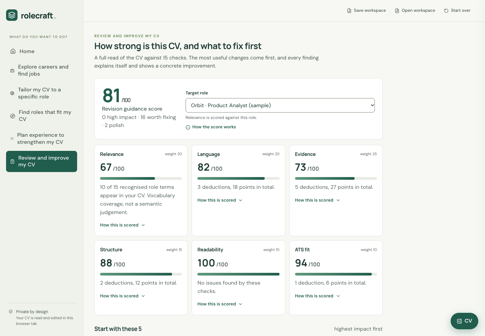
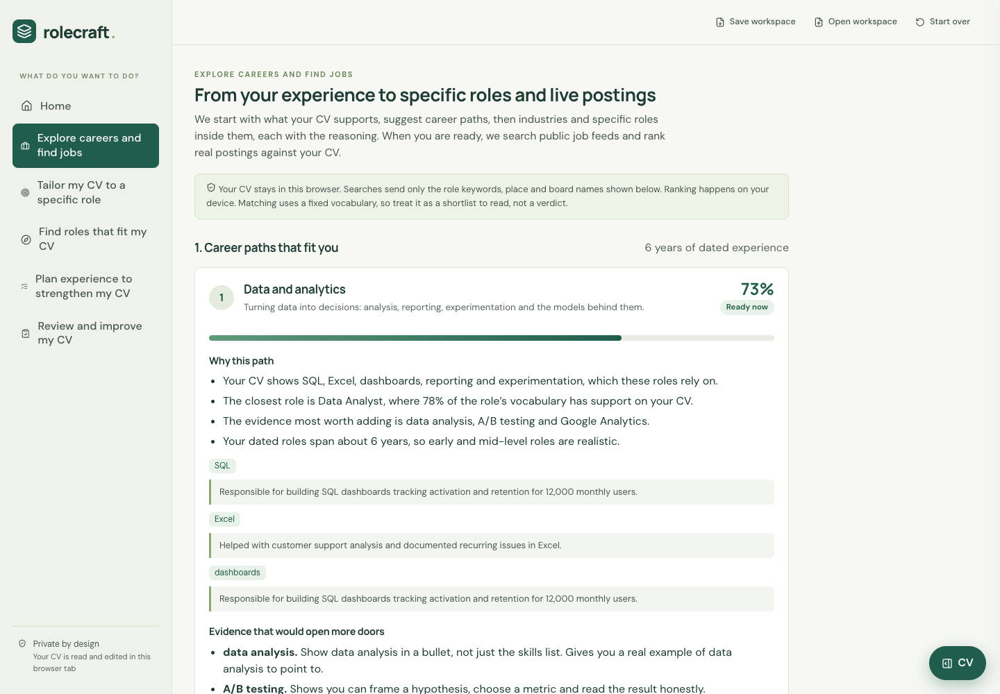

# Rolecraft

A CV studio that runs entirely in the browser: load a CV, explore careers, tailor it to a role, find gaps or get an explainable score. No AI service, no account and no server-side storage; every suggestion points back to a line you wrote.



## What it does

- **Explore careers:** paths, industries and roles ranked by fit, each justified with quoted CV lines.
- **Tailor to a role:** paste a job description for requirement-by-requirement evidence and word-level proposed edits. Edits that need a fact ask for it and use only your answer; nothing is invented.
- **Plan experience:** roles grouped as ready, stretch or low overlap with the specific gaps, and projects ranked by how much demand they cover.
- **Review and export:** 15 checks feed six weighted score groups with every deduction shown; PDF, DOCX and text exports share one render model, and versions are immutable snapshots.

## Engineering

- **Deterministic and explainable:** fixed vocabulary and negation-aware matching ("Learning SQL" is not SQL experience), so results are repeatable. Scores are revision guidance, not hiring predictions.
- **Private:** parsing, scoring and export run client-side.
- **Model:** CV content and layout are separate (`lib/cv/types.ts`, tested in `tests/model.test.mjs`).
- **Untrusted input:** bounded DOCX extraction (2 MB expanded, no DTDs, 30,000 characters), PDFs capped at 20 pages, uploaded text only rendered as text. See [SECURITY.md](SECURITY.md).
- **CI:** typecheck, eight test suites, lint, formatting, dependency audit and production build on every push.



Stack: React 19, TypeScript, Next.js app router on Vite (vinext), Cloudflare Workers config, PDF.js, jsPDF, docx.

## Run

Node.js 24+. No environment variables; there is no hosted demo. The app makes no outbound requests and the Worker config has no bindings or secrets, so deploying it would cost nothing to run.

```sh
npm ci
npm run dev       # http://localhost:5173, then "Try a sample"
npm run check     # typecheck, tests, lint, formatting
```

## Limits

Scanned PDFs need OCR elsewhere. The vocabulary covers product, analytics, operations, design and common software roles, so niche suggestions are exploratory. Live job feeds are untested and switched off. See [docs/design-notes.md](docs/design-notes.md).

Began as a hackathon project; the [pitch deck](docs/hackathon/rolecraft-pitch-deck.pdf) is included. MIT licence (bundled Noto Sans under the SIL Open Font License).
